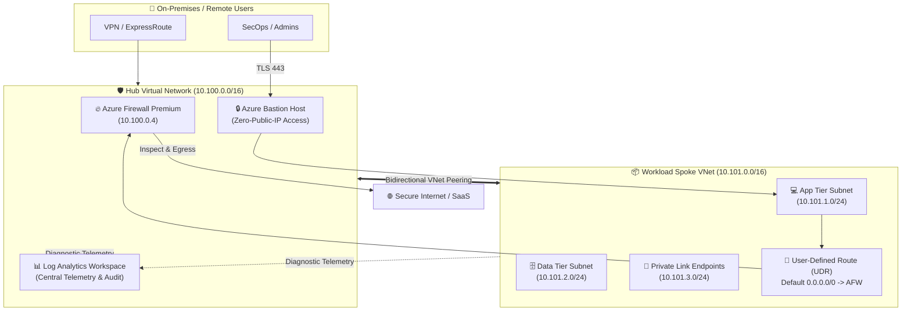

<div align="center">

# 🏛️ Azure Enterprise Landing Zone (CAF)
### Production-Grade Hub-and-Spoke Architecture with Zero-Trust Network Governance

[](#)
[](#)
[](#)
[](#)
[](#)

<p align="center">
  <b>Declarative, secure, and automated enterprise Cloud Adoption Framework (CAF) Landing Zone infrastructure on Microsoft Azure orchestrated via Terraform.</b>
</p>

</div>

---

## 📌 Executive Architecture Overview

This repository provisions an **Enterprise Azure Hub-and-Spoke Landing Zone** adhering strictly to the **Microsoft Cloud Adoption Framework (CAF)** and **CIS Azure Foundations Benchmark v2.0**.

It delivers a hardened perimeter, centralized egress/ingress inspection via **Azure Firewall**, zero-public-IP management using **Azure Bastion**, and strict network isolation across multi-tenant spoke virtual networks.



---

## ✨ Key Architectural Highlights

- 🔒 **Zero-Trust Network Perimeter:** All egress traffic from workload spokes is forcibly directed via User-Defined Routes (UDR) to Azure Firewall for deep packet inspection.
- 🚫 **Zero Direct Public IPs:** Compute and application workloads have zero public IP exposure; administrative access is restricted to Azure Bastion tunneling over TLS 443.
- ⚡ **Zone-Redundant High Availability:** Azure Firewall and Public IP resources are distributed across multi-availability zones (`["1", "2", "3"]`) for 99.99% SLA resilience.
- 📜 **Policy-as-Code & Drift Mitigation:** Shift-left security automation with Checkov, Trivy, and Terraform format checks built into GitHub Actions workflows.
- 💰 **FinOps Cost Discipline:** Tagging taxonomy enforces cost center allocation, data classification, and automated environment lifecycle decommissioning.

---

## 📂 Repository File Structure

```tree
azure-landing-zone/
├── .github/
│   └── workflows/
│       └── terraform-ci.yml      # CI lint, fmt, validate & Checkov scan
├── .gitignore                    # Enterprise git exclusion rules
├── main.tf                       # Hub, Spokes, Firewall, Bastion & UDR resources
├── variables.tf                  # Type-safe input variables with validation
├── outputs.tf                    # Critical resource IDs, IPs, and endpoints
├── versions.tf                   # Provider versions and Azure Blob remote state
├── terraform.tfvars.example      # Sample production configuration template
└── README.md                     # Architecture documentation
```

---

## 🚀 Quickstart & Deployment Guide

### Prerequisites
1. **Terraform CLI** >= 1.5.0
2. **Azure CLI (`az`)** >= 2.50.0
3. Active Azure Subscription with **Contributor** and **User Access Administrator** roles.

### 1. Authenticate with Azure
```bash
az login
az account set --subscription "<YOUR_SUBSCRIPTION_ID>"
```

### 2. Configure Variables
```bash
cp terraform.tfvars.example terraform.tfvars
# Edit terraform.tfvars to customize your IP address ranges and region
```

### 3. Initialize & Validate
```bash
terraform init
terraform fmt -check
terraform validate
```

### 4. Review Plan & Apply
```bash
terraform plan -out=landingzone.tfplan
terraform apply landingzone.tfplan
```

---

## 🛡️ Security & Compliance Guardrails

| Control Area | Implementation Standard |
|---|---|
| **Perimeter Security** | Azure Firewall with centralized application & network rule collections. |
| **Identity & Access** | Azure RBAC with Managed Identities, zero hardcoded secrets. |
| **State File Encryption** | Azure Blob Storage with customer-managed keys (CMK) and Blob Lease Locking. |
| **Traffic Encryption** | TLS 1.3 enforced on all external endpoints; private links for internal services. |
| **Audit Trails** | 90-day retention in central Log Analytics with diagnostic stream to Azure Monitor. |

---

## 📄 License
This architecture is licensed under the [MIT License](LICENSE).
